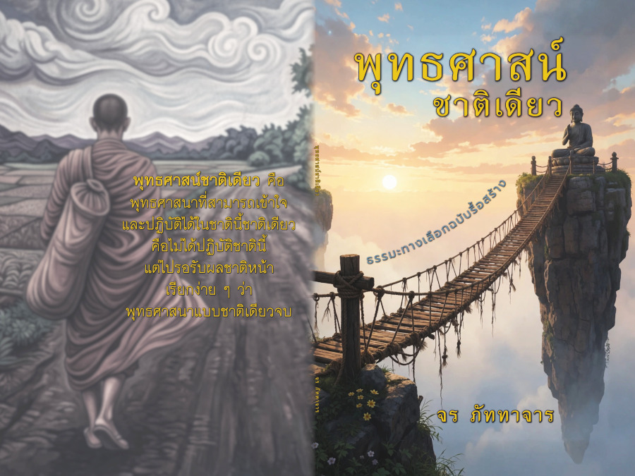

| --- | --- |
| ชื่อหนังสือ: | **พุทธศาสน์ชาติเดียว** (Buddhism for a Single Lifetime) |
| ชื่อรอง: | ธรรมะทางเลือกฉบับรื้อสร้าง |
| ผู้แต่ง: | จร ภัททาจาร |
| คำอธิบาย: | พุทธศาสนาภาคทฤษฎีเพื่อการปฏิบัติในชาติเดียว |
| ความหนา: | 112 หน้า (A5) |
| รหัสโครงการ: | bsl |
| ผู้ผลิตและเผยแพร่: | [อิสราศรม ทิศาปาโมกข์](https://www.facebook.com/disapamokkh){:target="\_blank"}  <svg class="icon"><use xlink:href="/assets/fontawesome/custom.svg#facebook-square"></use></svg>|
| เวอร์ชั่น: | {{ page.version }} |
| ไฟล์: | [พุทธศาสน์ชาติเดียว.pdf](https://drive.google.com/file/d/1er9kC5Ym0eSiQZdELKxnG5kdvXZgUioZ/view?usp=sharing) <svg class="icon"><use xlink:href="/assets/fontawesome/custom.svg#google-drive"></use></svg> |
| ไฟล์สำหรับพิมพ์: | [พุทธศาสน์ชาติเดียว_สำหรับพิมพ์.zip](https://drive.google.com/file/d/1taMF_QOIJMOKFBHCWdbG05cYnD1w_jqn/view?usp=sharing) <svg class="icon"><use xlink:href="/assets/fontawesome/custom.svg#google-drive"></use></svg> |

> **คำแนะนำการพิมพ์**
> 
> หนังสือเล่มนี้ยังไม่มีนโยบายจะส่งสำนักพิมพ์เพื่อการจำหน่าย ผู้สนใจสามารถพิมพ์ได้เองโดยใช้ไฟล์ที่เตรียมให้ หรือส่งร้านสำเนาเอกสารทำฉบับพิมพ์ให้
> 
> หนังสือเล่มนี้สามารถพิมพ์แบบหน้าคู่ด้วยกระดาษ A4 แล้วพับครึ่งเย็บกลางเล่ม (saddle stitch) ซึ่งมีไฟล์เตรียมไว้ให้ จะพิมพ์แบบหน้าเดี่ยวแล้วเข้าเล่มสันกาวหรือเย็บสันปกติก็ได้
> 
> สำหรับผู้ที่ต้องการพิมพ์แจกเป็นจำนวนมากสามารถทำได้โดยติดต่อหาโรงพิมพ์เอง ถ้าต้องการต้นฉบับที่มีข้อมูลเพิ่มเติม เช่นคำปรารภการพิมพ์หรือรายนามเจ้าภาพ ให้ติดต่อผู้เขียนโดยตรง
> 
> อิสราศรม ทิศาปาโมกข์อาจจะหาทุนมาพิมพ์เพื่อแจกหรือจำหน่าย เมื่อมีความคืบหน้าจะแจ้งให้ทราบอีกครั้งหนึ่ง

#### Preview


